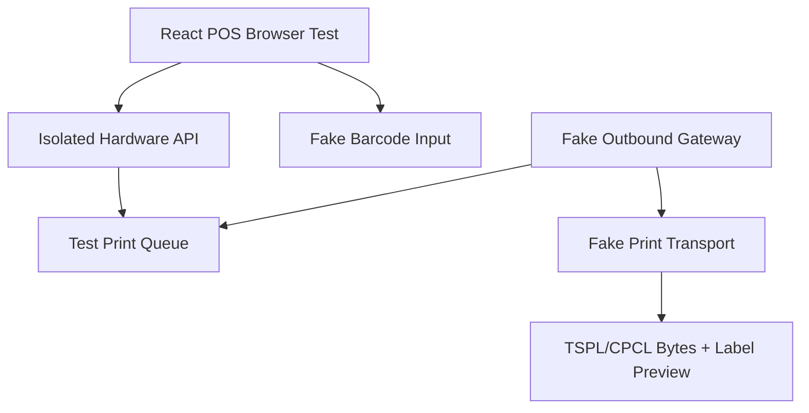
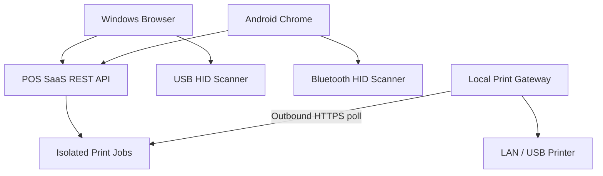

# Architecture — Browser POS + Optional Outbound Print Gateway

## Deployment profiles

| Profile | Devices at shop | Printing behavior | MVP support |
|---|---|---|---|
| A. PC stand-alone | Windows PC + USB/LAN printer | `window.print()` fallback; optional gateway for silent printing | Yes |
| B. Tablet + local gateway | Android Chrome tablet + Wi-Fi router + Windows PC/mini PC gateway + LAN printer | SaaS print jobs polled by gateway, silent printer operation on the gateway | Yes, once gateway tested |
| C. Tablet-only | Android Chrome tablet + compatible printer | Browser print dialog; only approved vendor SDK/Server Direct Print for silent/automatic | Browser print only in baseline |

Do not claim a Bluetooth printer works with Android Chrome in silent mode without a **model + firmware + browser + protocol** UAT. Bluetooth HID scanners are a separate category and typically act as keyboards.

## Virtual-first architecture mode (before devices arrive)

During approved development, replace the device-side implementation with test adapters **without opening USB, Bluetooth, serial or printer sockets**:

`FakePrintTransport` and `FakeBarcodeInput` are **test-only**; they never become live device connectors. Virtual tests can pass even while the USB driver/firmware/Bluetooth pairing/media handling remain untested. Required verdict is `VIRTUAL_PASSED / PHYSICAL_PENDING`, never `HARDWARE_VERIFIED` until real equipment is connected and physical UAT passes. Detailed policy is in `VIRTUAL_FIRST_DEVELOPMENT.md`.

## Owned hardware profile — mandatory v1.1 clarification

**CASHCOW CT420D is not the 80mm ESC/POS receipt printer in the baseline scenario.** It is a **TSPL/CPCL thermal label/waybill printer**, with USB, Bluetooth and Serial listed. Its USB connection can be used for a proposed label-print gateway after actual driver UAT. LAN, auto-cutter, cash drawer and ESC/POS are **not specified** on the supplied technical sheet. Do not infer them. Its print jobs must use an isolated `LabelTsplCpcl` adapter and `product_label`/`waybill` media type.

**CASHCOW HC-4208DB** is the owned 1D/2D scanner for PC (USB or 2.4GHz dongle) and Android Chrome (Bluetooth HID if configured). On both platforms verify actual scan-to-keyboard behavior and suffix Enter, rather than relying on transport marketing alone.

For the first pilot: build scanner and label printer test paths separately; a customer receipt printer must be provided and tested later to certify ESC/POS 80 mm printing. Do not route customer receipts to CT420D merely because its printhead is thermal.

## Component contracts

**Browser:** React/TypeScript device setup, HID scan input, validated receipt preview, `window.print()` fallback, user-scoped device selection. No arbitrary local HTTP printer requests.

**SaaS API:** owns authentication, tenant resolution, terminal registry, immutable receipt snapshot projection, new print jobs, device enrollment, idempotency, audit, and statuses. API and queue **namespace must not collide** with live POS.

**Gateway:** optional isolated service installed **only with shop-owner consent**. Recommend native Node.js/TypeScript or a small compiled binary, matching project's operational constraints; runtime decision follows technical spike. Polls over TLS with short-lived/scoped device credentials. It **must not require Docker**.

**Printer adapters:** separate registry with (1) generic ESC/POS receipt printer 80 mm LAN (typically TCP raw port, validate device config); (2) **CT420D TSPL/CPCL label printer**, USB via tested Windows driver/OS spooler or validated transport; (3) provider-specific Epson ePOS where actually supported. **Protocol/media type mismatch must be rejected.**

## Print protocol outline

1. Browser requests print for a **posted sale ID**, or an approved post-commit event schedules it.
2. Server confirms sale ownership/status and constructs immutable `ReceiptSnapshot` from source-of-truth.
3. Create job with unique idempotency key. Do **not** charge, settle or mutate sale again.
4. Authenticated gateway fetches eligible jobs **from** SaaS; claim with lease/version prevents concurrent consumption.
5. Gateway converts structured receipt → capability-aware ESC/POS/driver bytes → printer.
6. Gateway reports attempt/status; SaaS records event and informs authorized browser.
7. Timeout after possibly sending data → `uncertain`; warn rather than auto-repeat. Paper-out before send → safe bounded retry.

For cloud jobs, don't put raw ESC/POS byte arrays supplied by browser in the queue. Structured line items are derived server-side from an authorized source. Cash drawer commands are a separate privileged action.

## Network/security constraints

- No inbound port-forward/VPN from public SaaS to customer network. No permanent credentials embedded in JavaScript.
- Gateway initiates HTTPS with revocable device token scoped to one tenant/branch; pairing requires administrator + short-lived one-use code; store only token hash server-side.
- Avoid browser HTTPS → direct local HTTP (`192.168.x.x`) as the default path: mixed-content, browser permission and CORS rules vary. Direct vendor web SDK is a separate tested adapter.
- Browser profile cannot inspect the list of all printers across tenants. Device names/status masked or scoped to same branch.
- Server stores minimal receipt personal data; redact payment details from logs. Gateway never stores card credentials or payment secrets.
- Queue bounded per tenant, rate-limited, expiry/retention configurable, every attempt audit-logged.

## Unsupported assumptions

Do **not** assume Windows print driver is installed, printer has 9100/TCP, printer speaks standard Epson ESC/POS, Android browser supports arbitrary USB/Bluetooth printer access, or receipt printing guarantees physical receipt issuance. Verify and log device-specific capabilities.

**Virtual-first addition:** never infer device compatibility from mock/emulator success. Browser tablet emulation validates UI and synthetic keyboard events, **not** the Android Bluetooth stack or physical scanner latency. Label preview validates structured layout, **not** how CT420D actually feeds stock or prints dots.

## Failure matrix

| Failure | Correct result | Never do |
|---|---|---|
| Printer offline / paper empty | Sale remains posted; print failed/pending; visible retry | Revoke payment or duplicate sale |
| SaaS API offline | Existing POS online constraints apply; no invented offline checkout | Create unapproved offline sale cache |
| Gateway offline | Browser fallback if available; queue can wait with TTL | Expose printer directly to internet |
| Ack lost after printer accepted bytes | Mark uncertain and request manual inspection | Blindly re-send high-risk jobs |
| Duplicate POST/retry | Same logical job returned | Create repeated initial receipts |
| Wrong branch/device | Reject and audit | Spill receipt data into another tenant |
| Capability unsupported | Use configured safe fallback or explicit error | Fire unknown ESC/POS commands |
| CT420D receives receipt/ESC/POS job | Reject with `PRINTER_PROTOCOL_MISMATCH` and show suitable printer requirement | Send cutter/drawer/receipt bytes to TSPL/CPCL printer |
